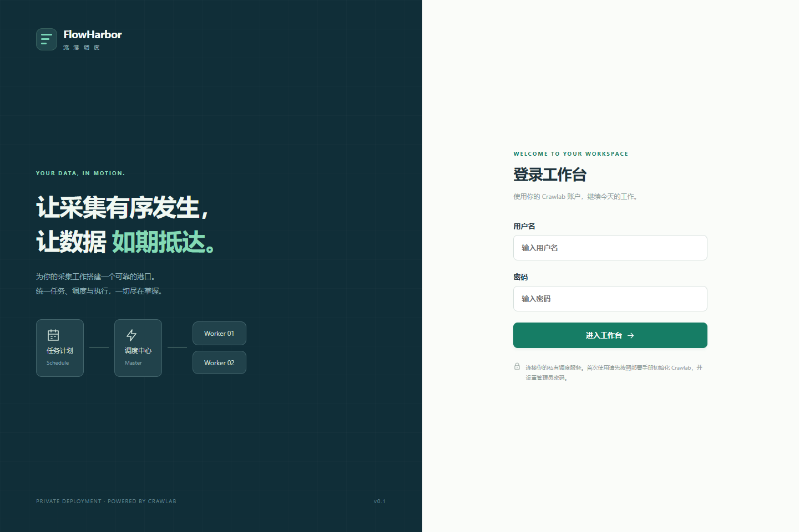

# FlowHarbor · 流港调度

基于 Crawlab 的私有部署采集调度工作台。独立中文界面提供项目分组、Python 任务管理、定时计划、节点选择、执行日志和结果查看；Crawlab 负责真正的任务排队、分发和执行。

**版本：0.1.0。交付形态：GitHub 私有源码仓库 + 买家源码包。** 本次实际验证结果见 [验证记录](docs/verification.md)，部署验收步骤见 [部署手册](docs/deployment.md)。



## 功能

- 创建项目与采集任务，设置运行命令、参数、优先级和执行节点。
- 上传 UTF-8 Python 文件，手动运行，查看执行状态、日志与结果。
- 使用五段 Cron 创建定时计划，启用、暂停或删除计划。
- 查看节点在线状态与运行容量，取消任务或重新发起执行。
- 使用内置静态页面完成可重复的采集演示，无需依赖外部网站。

## 启动

需要 Docker Engine / Docker Desktop（Linux 容器）、Docker Compose v2 和 Python 3。首次构建需要访问容器仓库、PyPI、npm。默认部署目标为 Linux amd64，开发工具使用 Python 3.12、Node.js 22 和 pnpm 10。

```bash
python scripts/configure.py
docker compose up -d --build
docker compose ps
```

打开 **http://localhost:8080**。使用 Crawlab 账号登录；全新实例的初始账号请按 [部署手册](docs/deployment.md) 完成初始化和修改密码。Crawlab 原生控制台保留在 http://localhost:18080，仅绑定本机。

服务初次启动需等待 MongoDB、Crawlab 与工作节点完成初始化。界面显示连接错误时，可以通过 `docker compose logs --tail=100 master api` 查看实际启动日志。

## 工程结构

```text
frontend/          Vue 3 + TypeScript 管理界面
backend/           FastAPI 接入服务与边界测试
deploy/            容器构建和反向代理
examples/          采集脚本、测试页面与运行依赖
tests/integration/ 真实引擎集成验收
scripts/           环境配置和源码打包
docs/              架构、部署、使用、发布与验证记录
licenses/          第三方许可文本
.github/workflows/ 自动构建与测试
```

## 文档

- [部署与备份恢复](docs/deployment.md)
- [Windows 测试指南](docs/windows.md)
- [操作手册](docs/user-guide.md)
- [架构与接口设计](docs/architecture.md)
- [源码发布及买家交付](docs/release.md)
- [商品介绍草稿](docs/product.md)
- [实际验证记录](docs/verification.md)
- [第三方组件说明](THIRD_PARTY_NOTICES.md)

FlowHarbor 的原创部分按仓库 LICENSE 管理。Crawlab 等第三方组件保留各自许可。项目使用 Crawlab 引擎，不代表 Crawlab 官方背书。
