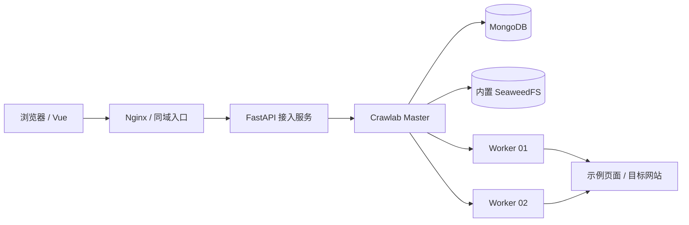

# 架构与设计

## 系统组成

前端展示产品流程；接入服务校验来自用户的字段、管理浏览器会话并调用固定版本 Crawlab API；Master 负责 Cron、队列、节点协调和代码同步；Worker 运行 Python 进程，SDK 将采集结果写入 Crawlab 数据集。接入层不建立第二套队列或调度时钟，任务与计划数据以 Crawlab 为准。

## 已核对的版本

- Crawlab：`v0.6.3`，源码提交 `2dbc7373eb33f2ecd2c13e6a408c90aa72574ca7`。
- 核心依赖：`crawlab-core` 提交 `25ed70356f13`，来自上述版本 `backend/go.mod`。
- API 路由及请求结构依据该核心版本 `routes/`、`controllers/`、`models/` 核对。
- Compose 使用固定镜像标签和官方 [manifest 摘要](https://hub.docker.com/layers/crawlabteam/crawlab/0.6.3/images/sha256-9dbe97240ba2670ce49fd1be5d557b59653e602d8fa29a71c9e05b26c557193b)，目标平台为 linux/amd64。实际镜像拉取和运行结果见验证记录。升级引擎前重新执行真实集成测试。

## 请求与认证

浏览器只访问同域 `/api`。FastAPI 使用 HttpOnly、SameSite=Strict 的 cookie，额外签名封装引擎令牌；签名密钥由每次初始部署独立生成。浏览器修改请求携带 `X-FlowHarbor-Request: 1`，来源与 `PUBLIC_ORIGIN` 匹配。HTTPS 部署设置 `COOKIE_SECURE=true`。

上游 0.6.3 的 JWT 密钥在源码中固定；因此原生控制台只绑定宿主机回环地址，接入层不接受浏览器自行提交的引擎 JWT。工作节点和文件同步使用独立生成的共享密钥。数据库、gRPC、文件服务不映射公网端口。

## 数据与持久化

| 数据 | 存放位置 | Compose 卷 |
| --- | --- | --- |
| 项目、任务、计划、账号、结果 | MongoDB | mongo-data |
| 任务代码、日志与文件 | Master `/data` | master-files |
| Master 身份 | `/root/.crawlab` | master-identity |
| Worker 身份 | 各节点 `/root/.crawlab` | worker-01-identity / worker-02-identity |

工作节点本地工作目录是同步后的执行副本，持久数据由 Master 文件服务与 MongoDB 保存。备份需要同时包含数据库、文件卷、节点身份和 `.env`。

## API

接入服务提供 `/api/projects`、`/api/spiders`、`/api/tasks`、`/api/schedules`、`/api/nodes`、`/api/overview`，以及登录、会话和文件接口。启动开发服务后访问 `http://127.0.0.1:8000/docs` 查看生成的 OpenAPI 文档。

写入边界使用 Pydantic；资源 ID 为 MongoDB ObjectID；脚本文件名必须是相对路径，禁止目录穿越。内部逻辑使用已解析类型。引擎不可达时返回明确错误，不用模拟任务填补页面。

单个部署面向一个可信运营团队。每个任务运行命令都在工作节点容器内执行，上传脚本属于运维权限。增加 Worker 时为节点使用独立身份卷，并保留共享文件及 gRPC 配置。
